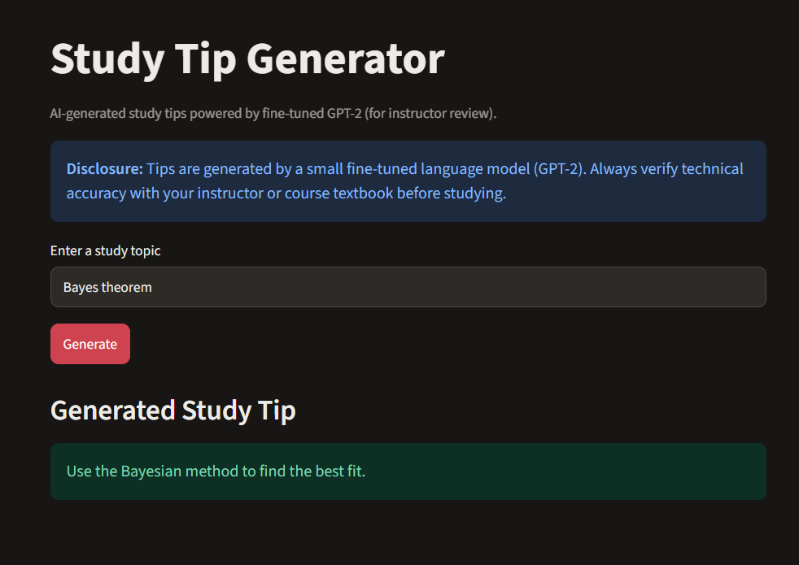
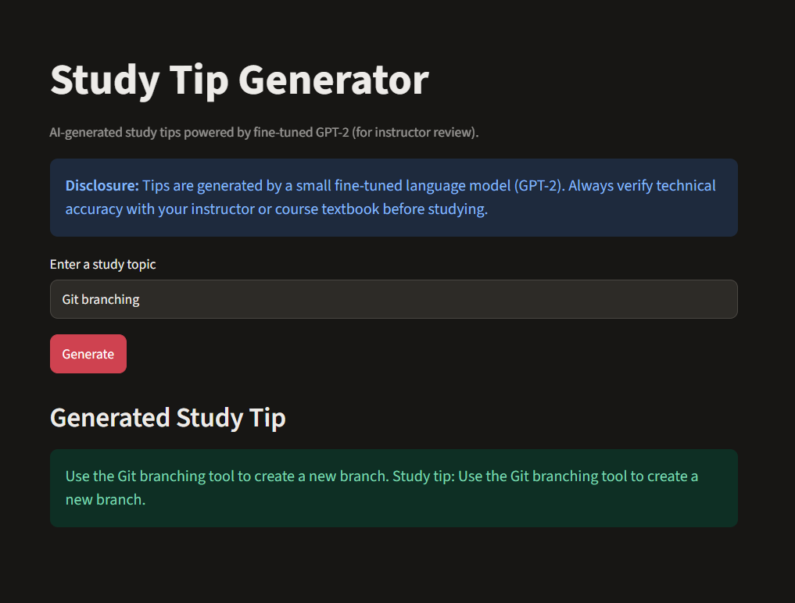
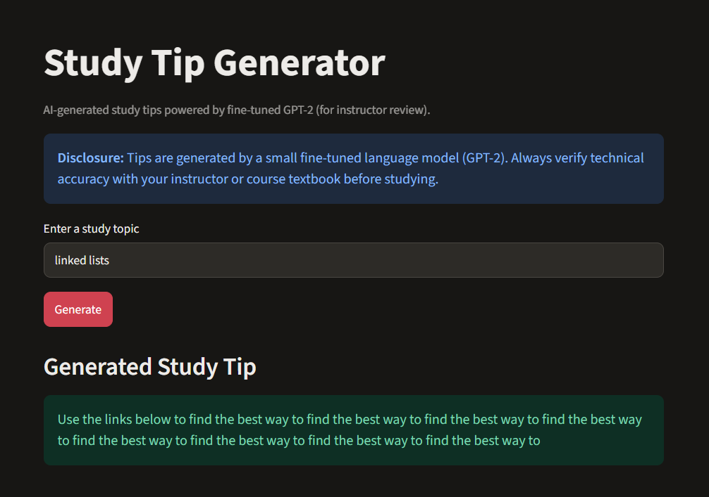

# ETMMGA304 — Capstone: AI Study Tip Generator (Fine-Tuned GPT-2 + Streamlit)

End-to-end Generative AI Capstone project for **ETMMGA304: Generative AI and Its Applications** (MCA — AI & ML, K.R. Mangalam University), featuring a fine-tuned GPT-2 model hosted on Hugging Face Hub (`YASH7080192/study-tip-gpt2`), structured rubric evaluation on 12 held-out topics, and an interactive Streamlit web application with AI disclosure.

## Repository Contents
- `Capstone_Study_Tip_Generator.ipynb` — Complete training and evaluation notebook (Google Colab T4 GPU, `SEED = 42`).
- `app.py` — Streamlit web application (supports local weights and automatic Hugging Face Hub fallback).
- `CAPSTONE_REPORT.md` — Full 24-row rubric scoring, failure analysis, and ethical/deployment review.
- `dataset/` — Curated training pairs (`train_tips.json`, 25 examples) and zero-overlap evaluation set (`held_out_topics.json`, 12 topics).
- `lab_outputs/` — Training loss curve (`capstone_training_loss.png`) and evaluation CSVs.
- `screenshots/` — Demonstration checks (empty input, held-out topics, and failure case).

## Evaluation Summary (12 Held-Out Topics)

| Metric | Base GPT-2 | Adapted GPT-2 | Change |
| :--- | :---: | :---: | :---: |
| **Mean Total Score (/6)** | `1.25` (SD = 0.75) | **`2.00`** (SD = 1.13) | **`+0.75` (+60.0%)** |
| **Mean Relevance (/2)** | `0.92` | `0.92` | `0.00` |
| **Mean Readability (/2)** | `0.25` | **`1.00`** | **`+0.75` (4×)** |
| **Mean Usefulness (/2)** | `0.08` | `0.08` | `0.00` |
| **Head-to-Head Wins** | 2 | **7** (3 ties) | Net `+5` topics |

## Streamlit Demo Previews

| Held-Out Topic: Bayes Theorem | Held-Out Topic: Git Branching | Failure Case: Linked Lists |
| :---: | :---: | :---: |
|  |  |  |

## Model Weights & Local Run
Fine-tuned weights are hosted on Hugging Face Hub: [`YASH7080192/study-tip-gpt2`](https://huggingface.co/YASH7080192/study-tip-gpt2).

```bash
pip install -r requirements.txt
streamlit run app.py
```

## Author
- **Yashvant Giri** — MCA (AI & ML), K.R. Mangalam University | [@YASH7080192](https://github.com/YASH7080192)
